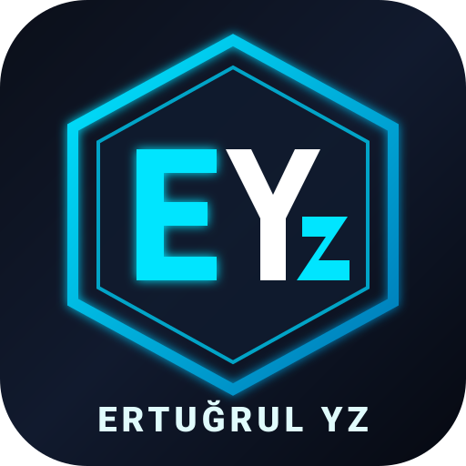
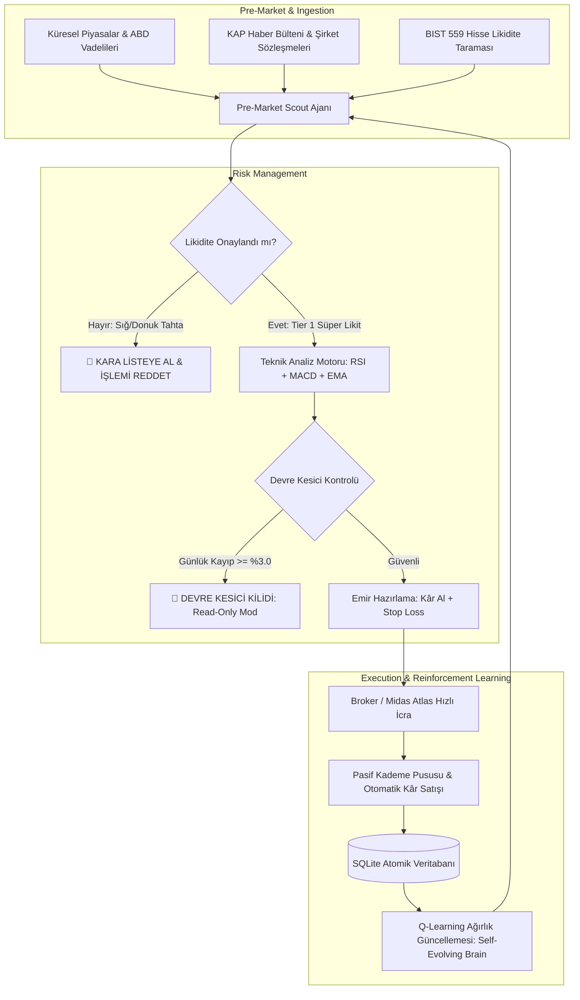

# 🦅 Ertuğrul YZ - Autonomous Algorithmic Trading & Scalping Engine

<div align="center">



**Türkiye Finansal Piyasaları (Borsa İstanbul - BIST, VİOP, Varantlar) İçin 7/24 Dayanıklı, Sıfır Duygusal Yanlılıkla Çalışan, Q-Learning Tabanlı Otonom Kantitatif Ticaret Motoru**

[](https://www.python.org/downloads/)
[](#)
[](https://opensource.org/licenses/MIT)
[](#)
[](#-katkıda-bulunma-contributing)

</div>

---

> [!CAUTION]
> ### ⚖️ YASAL UYARI VE SORUMLULUK REDDİ (LEGAL DISCLAIMER)
> **BURADA YER ALAN HİÇBİR BİLGİ, KOD, ALGORİTMA VEYA ANALİZ KESİNLİKLE BİR YATIRIM TAVSİYESİ DEĞİLDİR.**
> 
> Bu yazılım yalnızca **akademik, deneysel, eğitim ve yazılım mimarisi araştırma** amaçlarıyla geliştirilmiş açık kaynaklı bir projedir. Sermaye Piyasası Kurulu (SPK) mevzuatı kapsamında herhangi bir yatırım danışmanlığı faaliyeti içermez.
> 
> * Bu yazılımın, kodların, indikatörlerin veya botların kullanımından doğabilecek **hiçbir doğrudan veya dolaylı maddi/manevi zarardan, kâr kaybından, sermaye erimesinden veya teknik aksaklıktan proje sahibi, geliştiricileri veya katkı sağlayanlar KESİNLİKLE SORUMLU TUTULAMAZ.**
> * Finansal piyasalarda (BIST, VIOP, Varant, Kripto vb.) işlem yapmak yüksek düzeyde sermaye kaybı riski taşır. Tüm finansal kararlar ve riskler **tamamen ve münhasıran kullanıcının kendi şahsi sorumluluğundadır.**

---

## 📖 Projeye Genel Bakış (Executive Overview)

**Ertuğrul YZ Algoritmik Ticaret Motoru**, bireysel yatırımcıların karşılaştığı psikolojik tuzakları, ekran başında zaman kaybetme sorununu ve piyasa yapıcı spread (makas) engellerini ortadan kaldırmak için tasarlanmış kurumsal düzeyde bir kantitatif ticaret (quant trading) platformudur.

Sistem, geleneksel hisse al-sat botlarından farklı olarak **"Tek Kasa, Tek Odak ve Kuruş Kuruş Seri Scalping"** doktriniyle çalışır. Saatlerce ve günlerce pozisyonda atıl beklemek yerine, tahtadaki 1-2 kademelik fiyat sıçramalarını (+%1.5 - +%2.0) yakalar, kârı anında nakde kilitler ve sermayeyi bileşik getiriyle katlar.

---

## 🏛️ Mimari Şema ve Çalışma Döngüsü



---

## ⚡ Temel Modüller ve Yetenekler

### 1. 🛡️ 7/24 Dayanıklı Otonom Nöbetçi (`resilient_algo_trader.py`)
- **Otomatik İyileşme (Self-Healing):** Ağ kopması, API zaman aşımı veya bağlantı düşmelerinde çökmeyen, *Exponential Backoff* (katlanarak bekleme) ile yeniden bağlanan yapı.
- **%3.0 Sert Devre Kesici (Circuit Breaker):** Portföy gün içi çekilmesi %3.0'a ulaştığı milisaniyede tüm emir alımını dondurur ve sermayeyi korumaya alır.
- **Atomik Durum Kaydı (State Persistence):** Tüm açık pozisyonlar, emir durumları ve telemetri verileri yerel SQLite veritabanında saklanır.

### 2. 🎯 Kuruş Kuruş Hızlı Vur-Kaç Motoru (`trading_strategy.json`)
- **1 Kademe Kâr Realizasyonu:** Pozisyona girildiği an piyasa yapıcının bir kademe yukarısına anında limit kâr satış emri pasife yazılır.
- **Sıfır Bekleme Disiplini:** Kâr görüldüğü an cebe atılır; nakit serbest bırakılarak sıradaki fırsata aktarılır.
- **Varant ve Kaldıraç Entegrasyonu:** Küçük sermayeleri hızlandırmak için BIST 30 endeks ve hisse alım/satım varantlarında mikrosaniye hassasiyetinde işlem yeteneği.

### 3. 🔍 BIST 550+ Likidite ve Derinlik Filtresi (`bist_data_fetcher.py`)
- **Sığ Tahta Koruması:** Minimum 50 Milyon TL günlük hacim ve 1 Milyon lot işlem eşiğini geçemeyen 440'tan fazla sığ ve manipülatif hisseyi doğrudan eler.
- **Tier 1 Odak:** İşlemler sadece Türkiye'nin en derin 19 lokomotif hissesinde (THYAO, ASELS, GARAN, TCELL, ASTOR, TUPRS vb.) ve bunların resmi varantlarında yürütülür.

### 4. 📈 Gelişmiş Teknik Analiz Motoru (`bist_technical_analyzer.py`)
- **RSI (Wilder's Smoothing):** 14 periyotluk dinamik aşırı alım ve aşırı satım tespiti.
- **MACD (12, 26, 9):** Histogram ve sinyal çizgisi kesişimleriyle trend yönünün milisaniyelik onayı.
- **Çift Üstel Hareketli Ortalama (EMA 20 & EMA 50):** Ters yöndeki sahte kırılımları engelleyen ana trend filtresi.

### 5. 🧠 Kendi Kendini Eğiten Yapay Zeka Beyni (`self_evolving_brain.py`)
- **Pekiştirmeli Öğrenme (Q-Learning):** Seans içinde gerçekleşen her kâr ve zararı hafıza grafiğine (`brain_knowledge_graph.json`) işler.
- **Gece Seansı Analizi:** Borsa kapalıyken bile uyumaz; geçmiş seansların hatalarından ders çıkarıp ertesi günün strateji ağırlıklarını optimize eder.

### 6. 🕵️‍♂️ Seans Öncesi İstihbarat Ajanı (`pre_market_scout_agent.py`)
- Her sabah 08:00 - 09:55 saatleri arasında küresel vadelileri (S&P 500, Nasdaq), petrolü, dövizi ve şirketlerin sabah KAP bildirimlerini tarayarak Karar Birimine hazır istihbarat paketi sunar.

---

## 📂 Dizin ve Dosya Mimarisi

```
ertugrul-yz-trading-engine/
│
├── autonomous_brain/
│   ├── core/                                # Çekirdek Algoritma Motorları
│   │   ├── resilient_algo_trader.py         # 7/24 Devre Kesicili Ana Trading Ajanı
│   │   ├── bist_technical_analyzer.py      # RSI, MACD, EMA Kantitatif Analizör
│   │   ├── bist_data_fetcher.py             # Sığ Tahta & Likidite Güvenlik Filtresi
│   │   ├── self_evolving_brain.py           # 7/24 Q-Learning Kendi Kendini Eğiten Beyin
│   │   ├── pre_market_scout_agent.py        # Sabah KAP & Piyasa İstihbarat Ajanı
│   │   └── tavan_taban_technical_auditor.py # Tavan/Taban Mum ve Hacim Analizörü
│   │
│   ├── memory/                              # Yerel Veritabanı ve Hafıza
│   │   ├── trading_engine_state.db          # SQLite Atomik İşlem Kayıtları
│   │   ├── brain_knowledge_graph.json       # Pekiştirmeli Öğrenme Bilgi Grafiği
│   │   └── pre_market_decision_brief.json   # Günlük Karar Bültenleri
│   │
│   ├── models/                              # Strateji Genomları ve Ağırlıklar
│   │   └── strategy_weights.json            # Evrimsel Strateji Katsayıları
│   │
│   ├── reports/                             # BIST Taramaları ve Raporları
│   │   ├── bist_all_universe_classified.json# 559 Hissenin Likidite Haritası
│   │   └── tavan_taban_technical_deepdive.json # Mum Kırılım Raporları
│   │
│   └── research/                            # Açık Kaynak Kütüphane Araştırmaları
│       └── borsajs/                         # Türkiye Finansal Piyasaları Veri Motoru
│
├── config/                                  # Strateji Yapılandırmaları
│   └── trading_strategy.json                # Kuruş Scalping Parametreleri
│
├── .gitignore                               # Hassas Veri ve Anahtar İzolasyon Zırhı
└── README.md                                # Detaylı Dokümantasyon
```

---

## 🛠️ Kurulum ve Çalıştırma

### 1. Depoyu Klonlayın
```bash
git clone https://github.com/ertugrul34660/ertugrul-yz-trading-engine.git
cd ertugrul-yz-trading-engine
```

### 2. Bağımlılıkları Yükleyin
```bash
pip install pandas numpy yfinance
```

### 3. Seans Öncesi Taramayı Başlatın
```bash
python autonomous_brain/core/pre_market_scout_agent.py
```

### 4. 7/24 Otonom Motoru Devreye Alın
```bash
python autonomous_brain/core/resilient_algo_trader.py
```

---

## 🤝 Katkıda Bulunma (Contributing)

Bu proje tüm açık kaynak geliştiricilerinin, kantitatif analistlerin ve finans mühendislerinin katkılarına açıktır. Projeye katkı sağlamaktan memnuniyet duyarız!

1. Bu projeyi **Fork** edin.
2. Özellik dalınızı oluşturun (`git checkout -b feature/yeni-algoritma`).
3. Değişikliklerinizi commit edin (`git commit -m 'feat: Yeni hacim osilatörü entegrasyonu'`).
4. Dalınıza push yapın (`git push origin feature/yeni-algoritma`).
5. Bir **Pull Request (PR)** açın.

### Katkı Sağlanabilecek Alanlar:
- [ ] Yeni teknik indikatörler (SuperTrend, Ichimoku, VWAP)
- [ ] Derin öğrenme (LSTM / Transformer) fiyat tahmin modelleri
- [ ] Canlı veri sağlayıcıları için yeni API köprüleri
- [ ] Web arayüzü ve gerçek zamanlı gösterge paneli (Dashboard)

---

## 📜 Lisans

Bu proje **MIT Lisansı** ile lisanslanmıştır. Detaylar için [LICENSE](LICENSE) dosyasına bakabilirsiniz.

---

<div align="center">

**Geliştirici & Mimar:** [Ertuğrul YZ Ecosystem](https://github.com/ertugrul34660)  
*Finansal Özgürlük İçin Otonom Algoritmik Mühendislik*

</div>
